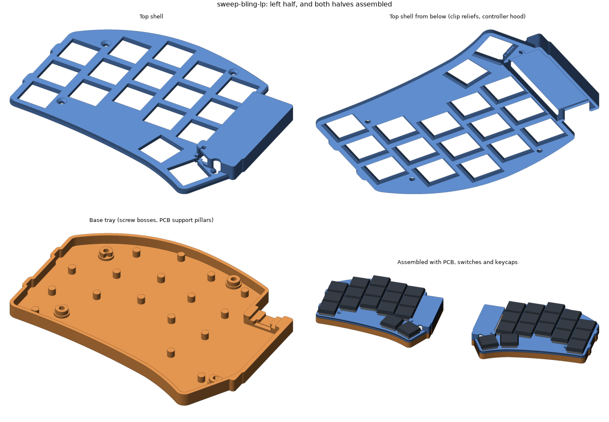
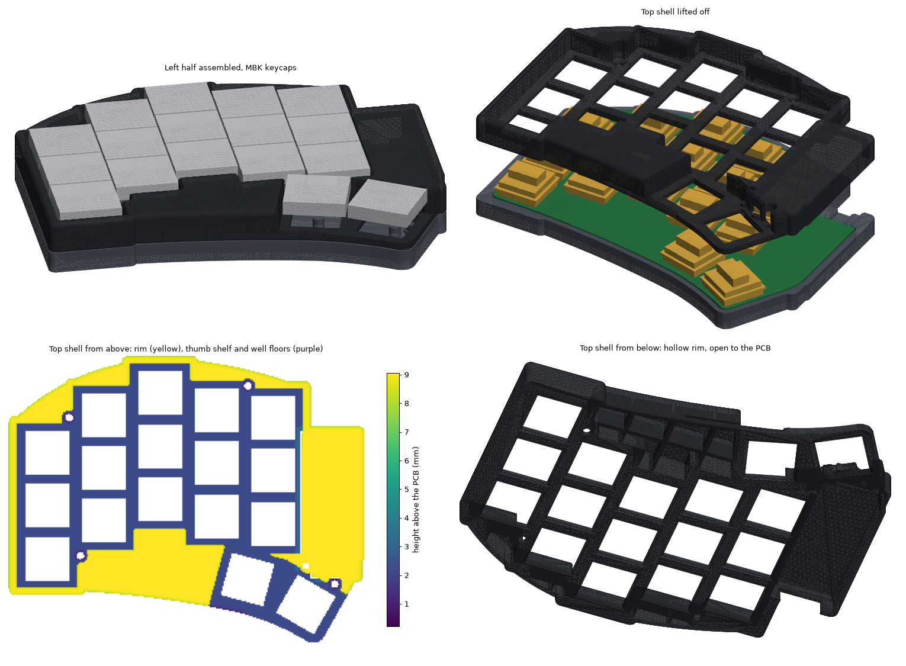
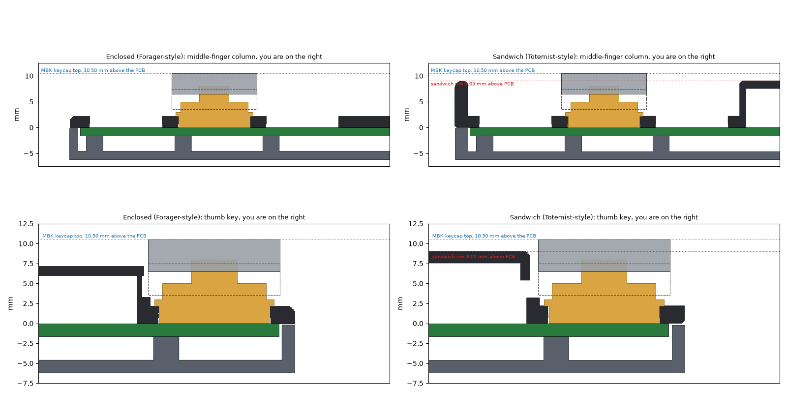

# Cases: Ferris Sweep Bling LP (wireless)

Two printable cases for keebmaker's Sweep Bling LP build. Each folder has its own STL files,
instructions and generator, so pick one and follow its README. Both are ordered the same way, in
resin from JLCPCB's 3D-printing service, and use the same PCB, screws, nuts, switches and keycaps.

| | [Enclosed](enclosed/README.md) | [Sandwich](sandwich/README.md) |
|---|---|---|
| Style | Like the PandaKB Forager: a flat 2.2 mm plate, switches and keycaps stand on top | Like ErgoMech's Totemist (and GEIST's TOTEM): keycaps sit in wells, the rim comes up to just under their tops |
| Top shell | Plate on the PCB, plus a raised hood over the nice!nano | The same plate at the bottom of the wells, with a rim 9.05 mm above the PCB that covers the nice!nano |
| Base | Tray with nut pockets and pillars | The same tray, up to 2.5 mm wider along the pinky and front edges |
| Desk to plate / rim / keycap tops | 8.4 / – / 16.7 mm (13.4 mm to the hood) | 8.4 / 15.3 / 16.7 mm |
| Footprint per half | 112.9 × 90.9 mm | 113.6 × 91.7 mm |
| Hardware per half | 4 × M2×8 countersunk screws, 4 × M2 nuts | The same |
| Resin for both halves | ~53 cm³ (with the switch coupon) | ~66 cm³ |
| Optional switch film | Yes | Yes (its own cut files) |





Side by side, cut through the middle-finger column and a thumb key:



**Which one?** The enclosed case is the simpler print, and the keycaps are easy to reach. The
sandwich case looks and feels like the Totemist: the switches are hidden, and the rim guards the
keycaps from the side. The trade-off is that its wells hold sweat on the plate, where a flat plate
lets it run off the edge. Both keep the PCB covered, the switches clipped into a plate and every
wire inside.

## Layout

```
case/
├── pcb/sweepbling-lp.kicad_pcb   the board both cases are built from (Solderpad Hardware License v2.1)
├── enclosed/                     Forager-style case: README, generate_case.py, stl/
└── sandwich/                     Totemist-style case: README, generate_case.py, sandwich.py, stl/
```

The sandwich generator reuses the enclosed generator for the board, plate and base, so a change to
the plate or base settings in `enclosed/generate_case.py` carries over to both.
